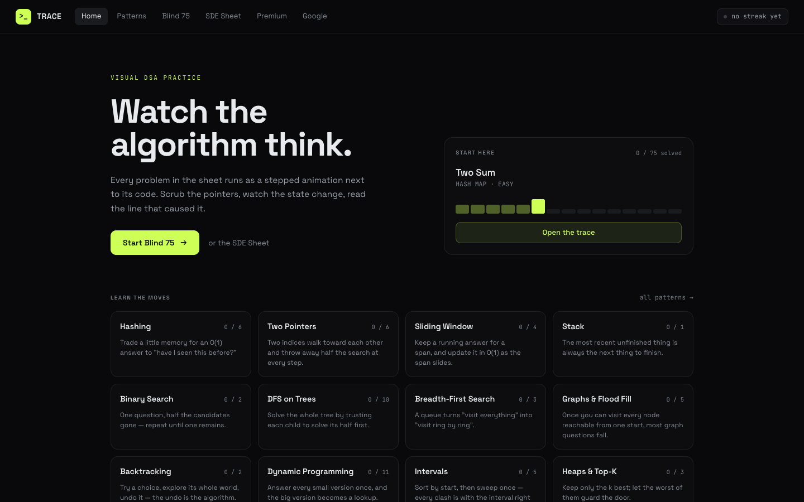
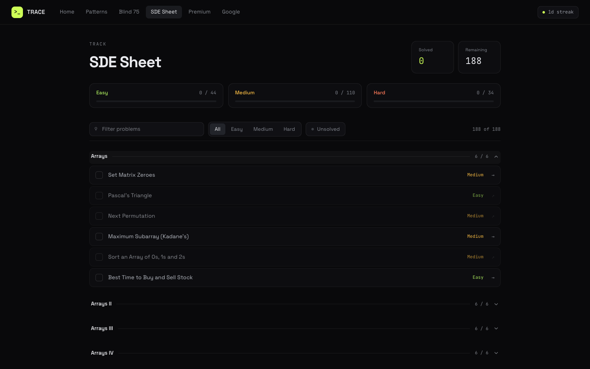
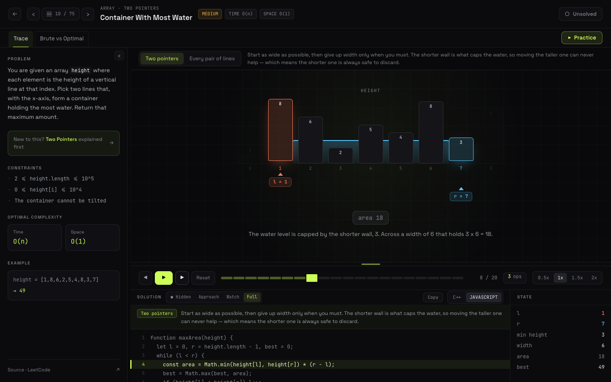
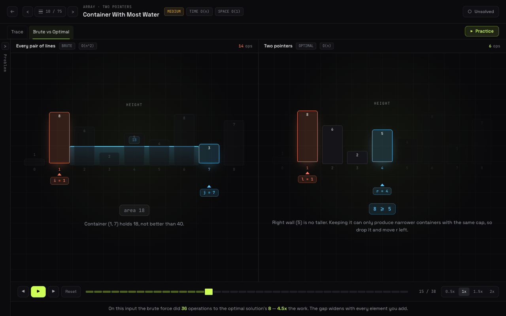
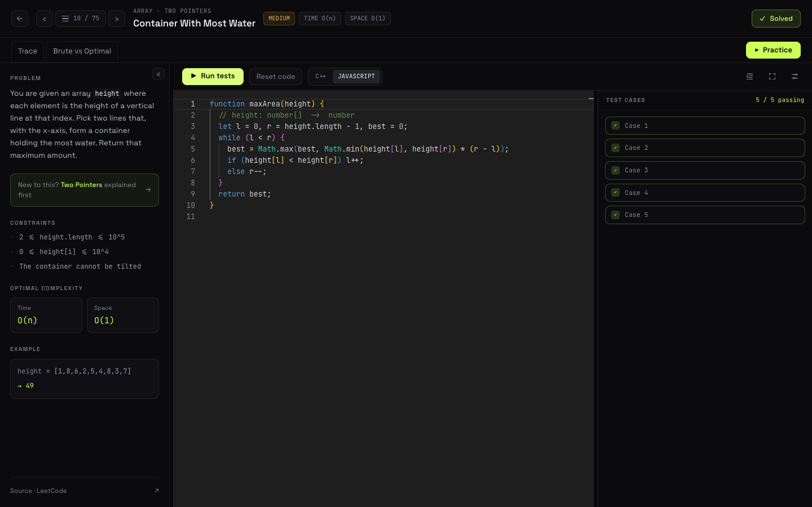
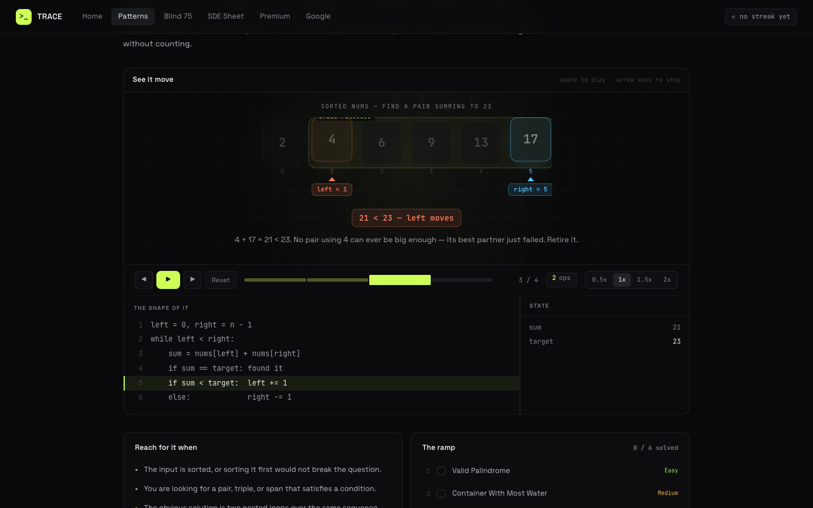

# TRACE

TRACE is a visual practice app for data structures and algorithms interview
problems. A traced problem plays as a stepped animation next to the code that
produced it, and every problem with tests can be solved in an in-browser editor
against the same test table.

It is a static Next.js app. There is no database, no account system and no
backend. Progress, drafts and settings live in the browser's `localStorage`.



## Tracks

| Track | Route | Problems |
|---|---|---|
| Blind 75 | `/practice` | 75, every one with a trace |
| SDE Sheet | `/sde` | 188 over 27 days; 43 open in the player, the rest link out to LeetCode |
| Google | `/company/google` | 62 |
| Premium | `/premium` | 89 LeetCode Premium problems, grouped by difficulty |

In total there are 208 problems: 76 have a trace, 205 can be run in Practice
(12 of them are class-style design problems), and 3 are statement-only.
Progress is stored per problem, so a problem that appears on two tracks is
solved on both at once.



## The player

Each problem opens at `/p/<id>` with up to three tabs.

| Tab | What it does |
|---|---|
| **Trace** | Stepped animation with the current code line highlighted, live variable state, a scrub bar and speed control. `space` plays, `←`/`→` step. |
| **Brute vs Optimal** | Both solutions animate on the same input side by side, with an operation count for each. |
| **Practice** | A Monaco editor. Your solution runs against the problem's test table, and passing every case marks the problem solved. |

The solution under the Trace tab starts hidden. You can reveal the approach,
earn each line as the trace executes it, or reveal it in full. A full reveal is
recorded, and the sheets mark a problem solved without one with a diamond.

A problem without a trace opens on Practice and shows its reference solutions
under a Solutions tab instead.







## Languages

Practice supports JavaScript and C++.

| Language | Where it runs |
|---|---|
| JavaScript | In a Web Worker in your browser tab, stopped after 8 seconds and capped at 5,000 lines of output |
| C++ | Sent to [Compiler Explorer](https://godbolt.org) (godbolt.org) and compiled there with g++ 14.1 |

C++ code leaves your machine: pressing Run tests in C++ sends your source to
godbolt.org's public API, which compiles and runs it. That is the only runtime
call the app makes other than loading the Monaco editor from the jsDelivr CDN
and fonts from Google Fonts.

## Patterns

`/patterns` lists 14 pattern intros: hashing, two pointers, sliding window,
stack, binary search, DFS on trees, BFS, graphs and flood fill, backtracking,
dynamic programming, intervals, heaps, tries and bit manipulation. Each one has
a short explanation, a small demo animated by the same trace engine, signals for
when to use it, and a ramp of problems from easiest to hardest.



## Self test

`/selftest` runs every trace and every reference solution against the
problem's own tests, checks that every trace step maps to a real code line in
both languages, and measures each solution's growth against its stated Big-O.
`npm test` runs the same check.

## Tech stack

- Next.js 16 (App Router, statically prerendered) and React 19
- TypeScript
- Sass modules
- Zustand for state, persisted to `localStorage`
- Monaco editor through `@monaco-editor/react`
- Vitest

## Local setup

Requires Node.js 20.9 or newer.

```bash
npm install
npm run dev      # http://localhost:3000
npm test         # vitest, including the authored-data self test
npm run build    # production build
npm run lint
```

## How traces work

A trace is not a hand-drawn animation. A solution is written once with
`t.push(...)` calls in it, and running it produces an array of frames. Each
frame is a complete snapshot of the algorithm's state, so stepping backwards
and jumping anywhere on the scrub bar need no extra work.

A small set of generic renderers covers every problem: array, bars, string,
grid, linked list, tree, stack and hash map. Adding a problem means writing a
solution, not drawing code.

```ts
trace(t, [nums, target]) {
  t.push({
    step: 'read',                       // -> code.map.read, per language
    note: 'Plain-English explanation of this exact step.',
    view: arr(nums, {
      tones: { 0: 'done', 1: 'active' },
      pointers: [{ name: 'i', at: 1, accent: 'a' }],
    }),
    vars: [['i', 1, 'a'], ['need', 7, 'c']],
    badge: { text: 'need 7', accent: 'c' },
  })
}
```

Each solution carries its code per language as `{ lines, map }`, where `map`
sends a step key to a 1-based line number. One trace then highlights the right
line in both C++ and JavaScript.

## Project structure

```
src/
  app/          routes: home, tracks, /p/[id], /pattern/[id], /patterns, /selftest
  components/   Player, Practice, CompareView, Sheet, TopNav and the rest of the UI
  lib/          the trace model (types.ts), test harness, judge, store, self-check
  problems/     one file per problem, the track tables, index.ts and meta.ts
  patterns/     one file per pattern intro
  runners/      runJS (Web Worker) and runCpp (Compiler Explorer)
  viz/          one renderer per view kind, plus the shared colour palette
  styles/       shared Sass tokens and mixins
```

## Adding a problem

1. Create `src/problems/<slug>.ts` exporting a `Problem` (the type is in
   `src/lib/types.ts`). `src/problems/3sum.ts` is a small complete example.
2. Register it in `PROBLEMS` in `src/problems/index.ts` and add its row to the
   table in `src/problems/meta.ts`. `npm test` fails if the two disagree.
3. A sheet row links to the problem when the problem's id matches the row's
   slugified title.
4. Run `npm test`, or open `/selftest` on a running build.

A problem needs a `signature` (or a `design` for a class-style problem), a
`tests` table, `starter` code per language and at least one solution. A `trace`
and a `demo` input make it animated; a second solution with `kind: 'brute'`
adds the Brute vs Optimal tab.

## Deploy on Vercel

The app needs no environment variables and no server-side services.

1. Push the repository to GitHub.
2. In Vercel, choose **Add New → Project** and import the repository.
3. Keep the detected settings: framework Next.js, build command `npm run build`,
   install command `npm install`.
4. Deploy.

Every route is prerendered at build time. The Vercel CLI works too: run
`vercel` from the project root.
